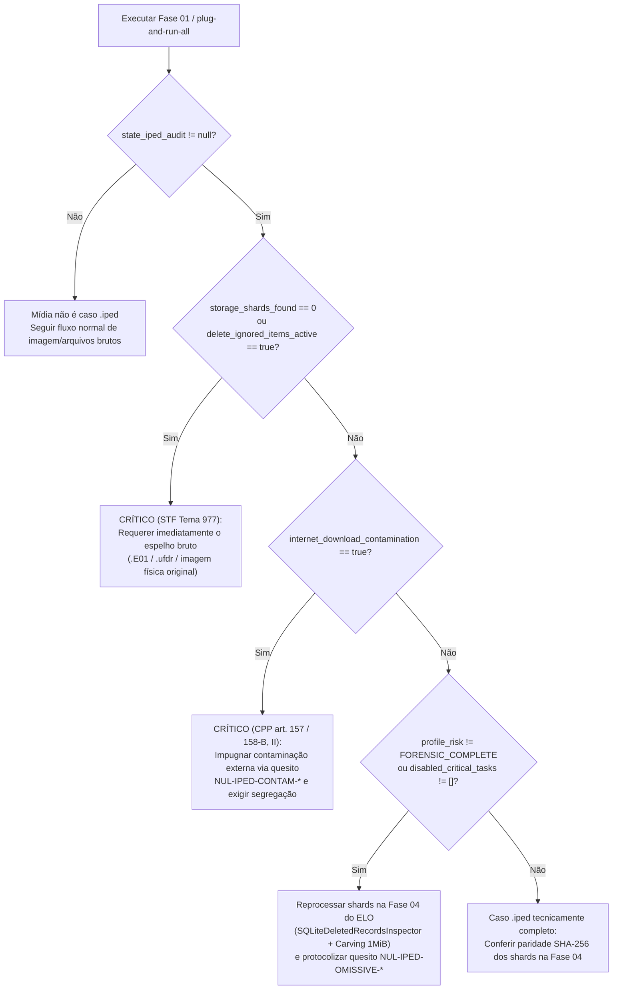
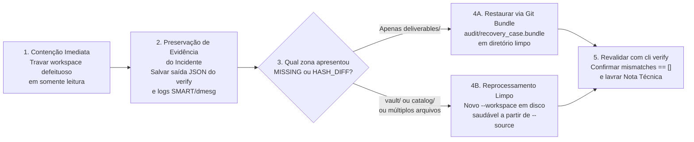
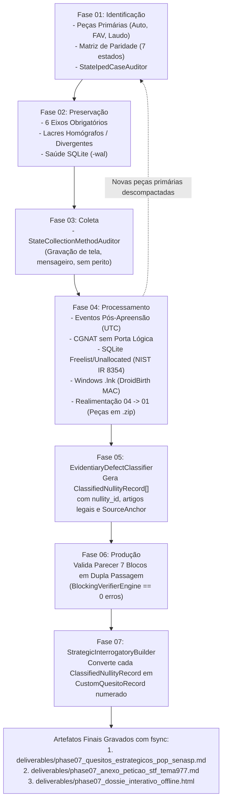

# Manual de Utilização para Operadores Forenses (`OPERATORS_MANUAL.md`)

| Metadado Operacional | Especificação Oficial |
| :--- | :--- |
| **Plataforma** | ELO — Motor Determinístico *Plug-and-Analyze* (EDRM 2.0 + Evolução Delta v2.1) |
| **Público-Alvo** | Peritos Oficiais Criminais, Assistentes Técnicos (CPP art. 159, § 5º) e Analistas de Laboratório Forense |
| **Escopo Central** | 1. Interpretação do `StateIpedCaseAuditor` · 2. Resposta a Divergências de Hash no Manifesto · 3. Fluxo de Geração de Quesitos Automáticos |
| **Referencial Técnico-Legal** | CPP arts. 158-A a 158-F e art. 159, §§ 5º–6º · STF Tema 977 · STJ RHC 184.003/SP · POP Senasp Vol. 5 (2024) · ISO/IEC 27037/27041/27042 · NIST IR 8354 |

---

## Sumário Rápido

1. [Pré-Requisitos de Execução Imutável](#1-pré-requisitos-de-execução-imutável)
2. [Guia Completo de Interpretação do `StateIpedCaseAuditor`](#2-guia-completo-de-interpretação-do-stateipedcaseauditor)
3. [Protocolo de Resposta a Divergências de Hash na Verificação de Manifesto](#3-protocolo-de-resposta-a-divergências-de-hash-na-verificação-de-manifesto)
4. [Fluxo Correto para Geração de Relatórios de Quesitos Automáticos](#4-fluxo-correto-para-geração-de-relatórios-de-quesitos-automáticos)
5. [Checklist Final de Conformidade Pré-Protocolização Judicial](#5-checklist-final-de-conformidade-pré-protocolização-judicial)

---

## 1. Pré-Requisitos de Execução Imutável

Antes de operar qualquer mídia probatória real (`--source`), confirme na estação forense:

1. **Integridade do Motor ELO**:
   ```bash
   PYTHONPATH=src:. PYTHONHASHSEED=42 python3 tools/run_forensic_gates.py
   ```
   Prossiga **exclusivamente** diante de `RESULTADO GLOBAL: HOMOLOGADO (EXIT CODE 0)` (`12/12 PASS` nos portões `G0` a `G11`).
2. **Isolamento Estrito entre `--source` e `--workspace`**:
   - `--source`: mídia acautelada montada preferencialmente com bloqueador físico de escrita (*Hardware Write-Blocker*) e `mount -o ro,noatime,nodev,nosuid`. Em software, o ELO impõe automaticamente o `FsWriteBlockerGuard` e valida `PreScanSnapshot == PostScanSnapshot`.
   - `--workspace`: diretório vazio em armazenamento local rápido, completamente disjunto de `--source` (qualquer sobreposição dispara `WorkspaceOverlapError`).
3. **Determinismo Criptográfico**: fixe sempre `PYTHONHASHSEED=42` ao invocar a CLI em perícias oficiais para garantir ordenação canônica idêntica em qualquer reprodução futura.

---

## 2. Guia Completo de Interpretação do `StateIpedCaseAuditor`

Em investigações conduzidas pela Polícia Federal, Polícias Civis e GAECOs, é recorrente que a defesa ou o juízo recebam um **caso portátil `.iped`** pré-processado em vez (ou ao lado) da imagem bruta original. O módulo `StateIpedCaseAuditor` (`src/edrm/phase01_identification/domain/__init__.py`) inspeciona esse pacote **em modo 100% somente leitura** durante a Fase 01, sem depender de Java/JVM e sem alterar um único bit da mídia estatal.

### 2.1 Como o `StateIpedCaseAuditor` é Acionado e Onde Ler o Resultado

Ao executar `plug-hd` ou `plug-and-run-all`, a sonda da Fase 01 varre todos os arquivos de `--source` buscando marcadores estruturais de casos `.iped`:
- Executável ou pasta de configuração: `IPED-SearchApp.exe`, `iped/conf/`, `IPEDConfig.txt`, `LocalConfig.txt`, `TaskInstaller.xml`, `ParserConfig.xml` e arquivos `iped*.log`;
- Listas de busca: `palavras-chave.txt` ou `keywords.txt`;
- Catálogo e armazenamento: `sleuth.db` e os shards `iped/data/storage-0.db` até `iped/data/storage-15.db`.

> **Nota**: Se nenhum marcador `.iped` existir na mídia `--source`, o campo `"state_iped_audit"` no JSON de saída retornará `null` (`None`), indicando que a mídia não é um caso portátil `.iped`.

Para inspecionar diretamente o relatório estruturado após a execução:
```bash
PYTHONPATH=src PYTHONHASHSEED=42 python3 -m edrm.interfaces.cli plug-and-run-all \
  --case-id AUDITORIA-IPED-001 \
  --source /mnt/midia_iped_estatal \
  --workspace /var/elo_cases/auditoria_iped_001 \
  --json > /var/elo_cases/auditoria_iped_001_sumario.json

python3 -c '
import json, pathlib
s = json.loads(pathlib.Path("/var/elo_cases/auditoria_iped_001_sumario.json").read_text())
print(json.dumps(s["state_iped_audit"], indent=2, ensure_ascii=False))
'
```

### 2.2 Dicionário Interpretativo de Todos os Campos de `StateIpedAuditReport`

| Campo no JSON (`state_iped_audit`) | Tipo / Valores Possíveis | Significado Técnico Exato | Interpretação Pericial e Impacto Processual |
| :--- | :--- | :--- | :--- |
| `is_iped_case` | `bool` (`true`) | Confirma a detecção de estrutura portátil `.iped` na mídia sondada. | Habilita na Fase 04 a leitura direta imutável dos shards GZIP por `StateIpedStorageReaderAdapter`. |
| `case_root_rel_path` | `str` (ex.: `"."` ou `"03_caso_iped"`) | Caminho relativo onde reside a raiz do caso `.iped` dentro de `--source`. | Identifica exatamente qual subpasta da mídia contém a indexação estatal quando há múltiplos volumes entregues. |
| `profile_detected` | `"forensic"`, `"fastmode"`, `"triage"`, `"blind"`, `"pedantic"` | Perfil de execução extraído dos parâmetros `-profile` / `--profile` / `profile=` ou caminhos de configuração. | Perfis `fastmode` e `triage` priorizam velocidade operacional em detrimento da exaustividade pericial; `blind` extrai apenas hashes sem análise de conteúdo. |
| `profile_risk` | `FORENSIC_COMPLETE` · `FASTMODE_OR_TRIAGE_OMISSIVE` · `BLIND_HASH_ONLY` · `CUSTOM_MODIFIED` · `NOT_IPED_SOURCE` | Classificação consolidada de risco metodológico (`StateIpedProfileRisk`). **Atenção**: mesmo que `profile_detected` seja `"forensic"`, se houver qualquer tarefa crítica desabilitada, o ELO promove automaticamente `profile_risk` para `FASTMODE_OR_TRIAGE_OMISSIVE`. | Qualquer valor diferente de `FORENSIC_COMPLETE` demonstra que a indexação estatal pode ter deixado de recuperar provas exculpatórias latentes. |
| `disabled_critical_tasks` | Lista de strings dentre: `enableCarving`, `enableLedCarving`, `enableSQLiteUndelete`, `enableOCR`, `processUnallocatedSpace`, `hash:sha-256_omitted` | Relaciona nominalmente as 5 tarefas críticas configuradas como `false` em `IPEDConfig.txt`/configs, além da omissão do algoritmo `SHA-256` no parâmetro `hash=`. | - `enableSQLiteUndelete=false` ou `processUnallocatedSpace=false`: mensagens apagadas e páginas livres deixaram de ser extraídas.<br>- `enableOCR=false`: imagens de comprovantes ou prints escaneados ficaram invisíveis à busca textual.<br>- `hash:sha-256_omitted`: ausência de hash criptográfico forte moderno. |
| `suppressed_paths_or_hashdb` | `bool` | `true` quando `IgnoreFilesByPathTask`, `excludeKnown=true` ou `ignoreDuplicates=true` estão ativos. | Indica que arquivos conhecidos em HashDB estatal ou duplicados foram filtrados; exige verificar se a exclusão atingiu apenas binários de sistema ou também arquivos de usuário. |
| `delete_ignored_items_active` | `bool` | `true` quando `deleteIgnoredItemData=true`. | **Altíssima criticidade**: os bytes brutos dos itens classificados como "ignorados" foram fisicamente suprimidos dos shards `storage-*.db`, impedindo reexame independente sem o espelho original (**STF Tema 977**). |
| `internet_download_contamination` | `bool` | `true` quando `--downloadInternetData`, `-downloadInternetData` ou `LinkDownloader` (`enableLinkDownloader != false`) foi acionado. | **Contaminação externa da prova**: o indexador baixou dados ativos da internet durante o exame pericial, misturando conteúdo externo ao vestígio originalmente apreendido sob lacre (**CPP arts. 157 e 158-B, II**). |
| `keywords_negative_proof_warning` | `bool` | `true` quando há arquivo `palavras-chave.txt` / `keywords.txt` ou menção a `filterKeywords`. | **Alerta contra falsa prova negativa**: o método interno `Manager.filterKeywords()` do IPED oculta da interface palavras-chave que tiveram `0` hits. Logo, a ausência visual de um termo exculpatório na árvore de filtros não significa que ele não tenha sido pesquisado ou que os arquivos estivessem legíveis (ex.: cifrados sem OCR). |
| `storage_shards_found` | `int` (`0` a `16`) | Quantidade de bancos `iped/data/storage-0.db` .. `storage-15.db` encontrados fisicamente. | Se `storage_shards_found == 0` (com `sleuth_db_present == true`), o Estado entregou apenas metadados/catálogo seco **sem os arquivos brutos internos**, caracterizando cerceamento de defesa. |
| `sleuth_db_present` | `bool` | Indica presença do banco relacional `sleuth.db` (tabela `tsk_files`). | Permite ao ELO cruzar metadados do SleuthKit com os blobs reais armazenados nos shards `storage-0..15.db`. |
| `anchor` | `SourceAnchor` | Contém `origin_control_number`, `origin_path`, `locator="iped_config_audit"`, `verbatim_excerpt` e `origin_sha256`. | Fornece a citação probatória exata para transcrição literal no Parecer e nas petições. |

### 2.3 Árvore de Decisão Operacional Diante dos Achados do `StateIpedCaseAuditor`



---

## 3. Protocolo de Resposta a Divergências de Hash na Verificação de Manifesto

A plataforma ELO opera com **três níveis independentes de verificação criptográfica de manifesto**. Qualquer divergência (`Exit Code 1` ou exceção bloqueante) significa que houve alteração física pós-selagem, truncamento de armazenamento ou falha de mídia, exigindo rito estrito de resposta a incidentes.

### 3.1 Como Executar a Verificação Fria do Manifesto do Caso

Ao concluir a Fase 08, o adaptador `StagingCleanerAndBundleAdapter` grava `audit/MANIFESTO_SHA256.txt` cobrindo **100% dos arquivos** das 4 zonas permanentes (`vault/`, `catalog/`, `deliverables/` e `audit/`, exceto o próprio manifesto e `recovery_case.bundle`).

Para auditar o workspace a frio em qualquer momento:
```bash
PYTHONPATH=src python3 -m edrm.interfaces.cli verify --workspace /var/elo_cases/meu_caso
```
*(No Console Analítico Web, o mesmo comando é acionado pelo botão **"Auditar Manifesto"** na aba `07–08`.)*

### 3.2 Diagnóstico Exato dos Códigos de Falha Retornados

| Saída / Exceção Observada | Significado Exato no Código | Causas Físicas ou Operacionais Mais Comuns |
| :--- | :--- | :--- |
| `{"verified": true, "checked_files": N, "mismatches": []}` (`Exit Code 0`) | **Íntegro**: 100% dos arquivos relidos do disco possuem `SHA-256` idêntico ao selado na Fase 08. | Operação normal; entregáveis aptos para juntada judicial. |
| `{"verified": false, "error": "MANIFESTO_SHA256.txt ausente"}` (`Exit Code 1`) | O arquivo `audit/MANIFESTO_SHA256.txt` não existe no `--workspace` informado. | O processamento foi interrompido antes da Fase 08 (ex.: executou-se apenas `init-case` ou `plug-hd`) ou o caminho `--workspace` está incorreto. |
| `"MISSING:deliverables/<arquivo>"` ou `"MISSING:vault/<arquivo>"` | Arquivo listado no manifesto desapareceu do disco após o encerramento da Fase 08. | Exclusão manual acidental, quarentena indevida por antivírus corporativo sobre artefato extraído ou falha no sistema de arquivos. |
| `"HASH_DIFF:catalog/elo_forensic_catalog.sqlite"` | O banco SQLite do catálogo teve bytes alterados após a selagem da Fase 08. | Alguém abriu `elo_forensic_catalog.sqlite` em ferramenta externa (ex.: *DB Browser for SQLite* ou script Python) **sem** `?mode=ro&immutable=1`, alterando o cabeçalho/change-counter do SQLite. |
| `"HASH_DIFF:deliverables/<relatorio>"` | Um entregável Markdown, XML, DAT ou HTML5 foi modificado após a selagem. | Edição manual de texto pós-processamento (prática **estritamente vedada** na metodologia ELO) ou conversão automática de quebras de linha (`LF` $\leftrightarrow$ `CRLF`). |
| `"HASH_DIFF:vault/<evidencia>"` ou `CollectionHashMismatchError` | Divergência binária em arquivo dentro do cofre `vault/` (que já estava travado em `0o444`). | Corrupção silenciosa de hardware (*bit-rot* em disco sem ECC, setor defeituoso NVMe/SATA ou falha de memória RAM não-ECC). |
| `"HASH_DIFF:audit/audit_ledger.jsonl"` | O razão *append-only* sofreu acréscimo ou edição após a emissão do manifesto. | Nova operação escreveu no mesmo diretório `--workspace` já encerrado em vez de utilizar um novo diretório de execução. |
| `zero_source_mutation_confirmed: false` (`PreScan != PostScan`) | A mídia original `--source` sofreu alteração de tamanho, `mtime_utc_ns` ou `inode` durante a janela de execução. | Outro processo do sistema operacional (indexador Spotlight/Windows Search, gerenciador de arquivos montado em `rw`) tocou na mídia `--source` fora do processo Python. |

### 3.3 Procedimento Operacional Padrão (POP) em Caso de Divergência (5 Etapas)

> **REGRA DE OURO INEGOCIÁVEL**: **JAMAIS** edite manualmente o arquivo `audit/MANIFESTO_SHA256.txt` para "fazer o hash bater" e **JAMAIS** protocolize entregáveis de um workspace cujo comando `verify` retorne `verified: false`.



#### Passo 1 — Contenção e Isolamento do Workspace Afetado
Não apague nem sobrescreva o workspace que acusou divergência; preserve-o para diagnóstico causal:
```bash
# Salvar o diagnóstico exato com timestamp UTC
date -u +"%Y-%m-%dT%H:%M:%SZ" > /tmp/incidente_manifesto_log.txt
PYTHONPATH=src python3 -m edrm.interfaces.cli verify \
  --workspace /var/elo_cases/caso_afetado >> /tmp/incidente_manifesto_log.txt
```

#### Passo 2 — Verificação de Saúde Física da Estação e da Mídia `--source`
1. Caso a divergência esteja em `vault/`, verifique imediatamente erros de bloco/RAM no sistema operacional (`dmesg -T | tail -n 50` / `smartctl -a /dev/nvme0n1`). Se houver erro físico de disco na estação pericial, substitua o SSD de trabalho antes de prosseguir.
2. Caso o incidente tenha sido `PreScanSnapshot != PostScanSnapshot`, desmonte `--source` e remonte obrigatoriamente em modo somente leitura no kernel (`sudo mount -o remount,ro,noatime /mnt/midia_acautelada`).

#### Passo 3 — Recuperação de Entregáveis via `audit/recovery_case.bundle` (Quando `vault/` e `catalog/` Estão Íntegros)
Se um entregável em `deliverables/` foi acidentalmente aberto/modificado ou removido por engano, a Fase 08 mantém uma cápsula Git íntegra em `audit/recovery_case.bundle`:
```bash
# 1. Verificar a integridade criptográfica interna do Git Bundle
git bundle verify /var/elo_cases/caso_afetado/audit/recovery_case.bundle

# 2. Extrair cópia limpa dos entregáveis originais e do manifesto em diretório separado
git clone /var/elo_cases/caso_afetado/audit/recovery_case.bundle /var/elo_cases/caso_recuperado_bundle

# 3. Comparar o hash SHA-256 do arquivo restaurado contra o manifesto original
sha256sum /var/elo_cases/caso_recuperado_bundle/deliverables/*
```

#### Passo 4 — Reprocessamento Determinístico Integral (Solução Definitiva Padrão-Ouro)
Como `--source` permanece intacta, a forma mais limpa e juridicamente inatacável diante de corrupção em `catalog/` ou `vault/` é executar novamente `plug-and-run-all` apontando para um **novo diretório `--workspace` virgem** com a mesma semente `PYTHONHASHSEED=42`:
```bash
PYTHONPATH=src PYTHONHASHSEED=42 python3 -m edrm.interfaces.cli plug-and-run-all \
  --case-id CASO-RECONSTRUIDO-V2 \
  --source /mnt/midia_acautelada_ro \
  --workspace /var/elo_cases/caso_limpo_v2 \
  --json > /var/elo_cases/caso_limpo_v2_sumario.json

PYTHONPATH=src python3 -m edrm.interfaces.cli verify \
  --workspace /var/elo_cases/caso_limpo_v2
```
> **Dica Operacional sobre Consultas SQL Manuais**: Se precisar inspecionar `catalog/elo_forensic_catalog.sqlite` após o fechamento do caso usando `sqlite3` interativo, abra-o **sempre** em modo imutável para não sujar o hash do manifesto:
> ```bash
> sqlite3 "file:/var/elo_cases/caso_limpo_v2/catalog/elo_forensic_catalog.sqlite?mode=ro&immutable=1"
> ```

#### Passo 5 — Divergência nos Instaladores (`materialize_elo_platform.py` ou `materialize_docs.py`)
Se `python3 materialize_elo_platform.py --target <dir> --verify` ou `python3 materialize_docs.py --target <dir> --verify` acusar `MISMATCH:<rel_path>`, o arquivo instalador foi corrompido em trânsito ou o diretório `<dir>` sofreu interferência simultânea durante a gravação. Baixe novamente o script instalador, confira seu `SHA-256` e execute em diretório local vazio.

---

## 4. Fluxo Correto para Geração de Relatórios de Quesitos Automáticos

Na plataforma ELO, os quesitos periciais **nunca são textos genéricos pré-fabricados nem invenções livres de IA**: cada quesito é instanciado deterministicamente na **Fase 07** (`StrategicInterrogatoryBuilder.generate_quesitos`) exclusivamente a partir de anomalias materiais concretas comprovadas nas Fases `01` a `04` e tipificadas juridicamente na **Fase 05** (`EvidentiaryDefectClassifier.classify_all`).

### 4.1 Pipeline Determinístico de Ponta a Ponta para Geração dos Quesitos



### 4.2 Passo a Passo Operacional para Gerar os Quesitos com Máxima Cobertura

#### Etapa 1: Garantir a Presença das Peças Processuais Primárias na Entrada (`--source`)
Para que a Matriz de Paridade (Fase 01), os 6 Eixos (Fase 02) e o Detector de Contradições (Fase 05) gerem todos os quesitos cabíveis, certifique-se de incluir entre os parâmetros `--source` tanto a mídia bruta apreendida quanto a pasta contendo as peças estatais (`Auto de Apreensão`, `FAV`, `Mandado`, `Laudo Pericial`):

```bash
# Múltiplas fontes (--source) são suportadas nativamente em uma única execução!
PYTHONPATH=src PYTHONHASHSEED=42 python3 -m edrm.interfaces.cli plug-and-run-all \
  --case-id QUESITOS-CASO-2026-09 \
  --source /mnt/pecas_autos_principais_ro \
  --source /mnt/midia_bruta_entregue_ro \
  --workspace /var/elo_cases/quesitos_2026_09 \
  --json > /var/elo_cases/quesitos_2026_09_sumario.json
```
*(Mesmo que a `FAV` ou o `Laudo` estejam compactados dentro de um `.zip` na mídia, a Fase 04 os descompactará em `staging/` e acionará automaticamente a realimentação `04 -> 01`, atualizando a Matriz de Paridade para `revision_number >= 2` **antes** da Fase 05 e da Fase 07!)*

#### Etapa 2: Verificar a Aprovação Prévia da Fase 06 e Conferir o Manifesto da Fase 08
```bash
PYTHONPATH=src python3 -m edrm.interfaces.cli verify \
  --workspace /var/elo_cases/quesitos_2026_09
```
> **Importante**: Não utilize `plug-hd` isoladamente quando desejar gerar quesitos, pois `plug-hd` encerra na Fase 01. Execute sempre `plug-and-run-all` para atravessar as Fases `05`, `06`, `07` e `08` com selagem completa.

#### Etapa 3: Localizar e Inspecionar os 3 Entregáveis da Fase 07 em `deliverables/`

1. **`deliverables/phase07_quesitos_estrategicos_pop_senasp.md`**:
   Documento Markdown pronto para transcrição em petição de indicação de assistente técnico e formulação de quesitos (**CPP art. 159, § 5º, I**). Cada item traz:
   - Número sequencial (`1.`, `2.`, ...);
   - Fundamentação normativa entre colchetes (`[CPP art. 159, § 6º; STF Tema 977; ...]`);
   - Código rastreável da anomalia (`Ref. NUL-...`);
   - Pergunta técnica fechada e ancorada nos hashes/caminhos reais do caso.
2. **`deliverables/phase07_anexo_peticao_stf_tema977.md`**:
   Quadro sintético para petições de acesso à integralidade e memoriais/sustentação oral, consolidando todas as linhas críticas da Matriz de Paridade e contradições materiais.
3. **`deliverables/phase07_dossie_interativo_offline.html`**:
   Dossiê HTML5 autocontido (zero links externos/CDNs) contendo na **Seção 4** a lista completa numerada dos quesitos ao lado da linha do tempo interativa em UTC e dos cartões `SHA-256` do cofre.

### 4.3 Matriz de Mapeamento: Anomalia Detectada $\rightarrow$ Prefixo `nullity_id` $\rightarrow$ Quesito Automático

| Anomalia Técnica Comprovada no Caso | Prefixo `target_anomaly_id` | Categoria Jurídica (`EvidentiaryDefectCategory`) | Foco Técnico Exigido no Quesito Gerado |
| :--- | :--- | :--- | :--- |
| Caso `.iped` em perfil `fastmode`/`triage`, tarefas críticas desativadas, supressão HashDB, `deleteIgnoredItemData` ou alerta `filterKeywords` | `NUL-IPED-OMISSIVE-*` | `DEFENSE_PARITY_VIOLATION_TEMA_977` | Exige apresentação integral de `IPEDConfig.txt`, `LocalConfig.txt` e logs, justificativa para supressão de *carving*/*undelete*/OCR e esclarecimento sobre filtragem de prova negativa em `palavras-chave.txt`. |
| Flag `--downloadInternetData` ou `LinkDownloader` ativa em caso `.iped` estatal | `NUL-IPED-CONTAM-*` | `ABSOLUTE_NULLITY_ILLICIT_EVIDENCE` | Exige discriminação exata de todos os arquivos baixados da internet durante o exame que não integravam a mídia apreendida sob lacre (**CPP arts. 157 e 158-B, II**). |
| Registros recuperados de páginas `freelist`, espaço não alocado ou frames `-wal` em bancos SQLite | `NUL-SQLITE-UNALLOC-*` | `CUSTODY_BREAK_WEIGHT_REDUCTION` | Questiona se os registros citados provêm da B-Tree ativa ou de `freelist`/`-wal`, exigindo rotulagem de estado de alocação conforme **NIST IR 8354** e diretrizes **SWGDE**. |
| Atalho Windows `.lnk` contendo bloco `DistributedLinkTracker` (`MachineID`, `VolumeSerial`, `DroidBirth MAC`) | `NUL-LNK-PROVENANCE-*` | `CUSTODY_BREAK_WEIGHT_REDUCTION` | Exige confronto entre o endereço físico MAC `DroidBirth` / `MachineID` gravado no `.lnk` e as interfaces físicas reais do equipamento apreendido (**CPP art. 158-B, I e III**). |
| Mídia bruta declarada nos autos não entregue (`DECLARED_RAW_NOT_DELIVERED`) ou entregue cifrada/corrompida (`DELIVERED_ENCRYPTED_OR_CORRUPTED`) | `NUL-PAR-*` / `NUL-PAR-ENC-*` | `DEFENSE_PARITY_VIOLATION_TEMA_977` | Questiona se o espelho bruto integral foi acautelado com `SHA-256` e por qual razão técnica deixou de ser franqueado à Defesa (**CPP art. 159, § 6º**, **STF Tema 977** e **STJ RHC 184.003/SP**). |
| Eventos ou mutações com timestamp `UTC` posterior à data/hora oficial da apreensão (`is_post_seizure == True`) | `NUL-POST-*` | `ABSOLUTE_NULLITY_ILLICIT_EVIDENCE` | Exige esclarecer a origem da atividade pós-apreensão sob custódia estatal e comprovar uso de bolsa de Faraday / bloqueador de escrita (**POP Senasp Vol. 5 — 2024, itens 5.02 e 5.05**). |
| Divergência de hash/tamanho (`DIVERGENT_HASH_OR_SIZE`), ausência de hash na origem, vestígio sem FAV, quebra nos 6 Eixos, coleta por gravação de tela ou CGNAT sem porta lógica | `NUL-PAR-*`, `NUL-AX-*`, `NUL-COL-*`, `NUL-CGN-*` | `CUSTODY_BREAK_WEIGHT_REDUCTION` | Exige justificativa técnica confrontada com os **arts. 158-A a 158-F do CPP**, **POP Senasp Vol. 5 (2024)** e **Decreto n. 12.975/2026** (porta lógica de origem em IPs compartilhados). |

---

## 5. Checklist Final de Conformidade Pré-Protocolização Judicial

Antes de anexar o rol de quesitos (`phase07_quesitos_estrategicos_pop_senasp.md`) e o Parecer Técnico (`phase06_parecer_tecnico_7_blocos.md`) aos autos eletrônicos, valide todos os 6 itens abaixo:

- [ ] **1. Imutabilidade da Evidência Original**: No JSON de saída, `zero_source_mutation_confirmed` é `true` e `pre_scan_snapshot_sha256 == post_scan_snapshot_sha256`.
- [ ] **2. Calibração Prévia Aprovada**: `calibration_receipt.positive_control_passed == true`, `negative_numeric_mutation_blocked == true` e `negative_phantom_entity_blocked == true`.
- [ ] **3. Revisão Iterativa Consolidada**: Caso existissem arquivos `.zip`/`.ufdr` contendo autos ou FAVs, `phase01_final_revision >= 2`.
- [ ] **4. Sigilo Profissional OAB Preservado**: Comunicações cobertas pelo art. 7º, II, da Lei 8.906/94 constam segregadas em `privileged_excluded_cns` e não vazaram nos *Load Files* de produção.
- [ ] **5. Manifesto Criptográfico Frio Verificado**: `PYTHONPATH=src python3 -m edrm.interfaces.cli verify --workspace <DIR>` retornou `{"verified": true, "mismatches": []}` (`Exit Code 0`).
- [ ] **6. Rastreabilidade de Âncoras nos Quesitos**: Todo quesito selecionado para peticionamento mantém intacto seu identificador `target_anomaly_id`, o caminho relativo `anchor.origin_path` e o hash `anchor.origin_sha256` de 64 caracteres hexadecimais.

---

## 6. Operação Cross-Disk Entre HDs, Banco Mestre Organizado (`8 Views`), Servidor MCP e 6 Skills (Delta v2.2)

### 6.1 Preparação Única da Estação (`install_elo.py`)
```bash
python3 install_elo.py --setup-all
```
- Verifica Python 3.12+ e suporte nativo `SQLite FTS5`, lista todos os discos conectados e ferramentas opcionais (`ollama`, `tesseract`, `ffmpeg`, `iped`, `git`).
- Cria wrappers executáveis `bin/elo` (Linux/macOS) e `bin/elo.cmd` (Windows), executa a calibração **ISO/IEC 27041**, grava `.mcp.json` / `opencode.json` e instala as **6 Skills Operacionais** em `.claude/skills/` e `.opencode/skills/`.

### 6.2 Roteamento Seguro Entre HDs (`elo drives`, `elo wizard` e `elo autopilot`)
1. **Inspeção dos volumes conectados**:
   ```bash
   PYTHONPATH=src python3 -m edrm.interfaces.cli drives
   ```
2. **Abertura Guiada (`elo wizard`) ou Direta (`elo autopilot`)**:
   ```bash
   PYTHONPATH=src python3 -m edrm.interfaces.cli autopilot \
     --case-id CASO-OPERACAO-ALFA \
     --source /mnt/hd_1_prova_original \
     --dest /mnt/hd_2_destino_organizado/Operacao_Alfa \
     --staging /mnt/hd_3_temp_opcional
   ```
   - **Trava Anti-Auto-Contaminação**: Qualquer tentativa de apontar `--dest` ou `--staging` para dentro de `--source` é bloqueada imediatamente com `WorkspaceOverlapError`.
   - **Escolha Automática de Aquisição**: Seleciona `FULL_VAULT_COPY` se houver margem segura no HD de destino (`>= 120% + 64 MiB`) ou `REFERENCED_MANIFEST_STREAMING` quando o HD de prova supera o espaço livre do HD de destino.

### 6.3 Consulta ao `case_master_organized.sqlite` (8 SQL Views Executivas) e Operação via MCP
No segundo HD (`01_BANCO_ORGANIZADO/case_master_organized.sqlite`), abra sempre em modo imutável (`mode=ro&immutable=1`) ou utilize diretamente as **6 Skills de Agente** (`/elo-plugar-hd`, `/elo-panorama-caso`, `/elo-investigar-fato`, `/elo-auditar-custodia`, `/elo-confrontar-laudo`, `/elo-parecer-e-quesitos`) conectadas às **10 Ferramentas MCP** (`elo_list_mounted_drives`, `elo_autopilot_ingest_hd`, `elo_get_case_overview`, `elo_hybrid_search`, `elo_query_organized_view`, `elo_timeline_window`, `elo_audit_custody_and_parity`, `elo_confront_allegation_vs_raw`, `elo_verify_citation_strict` e `elo_generate_deliverables`).

