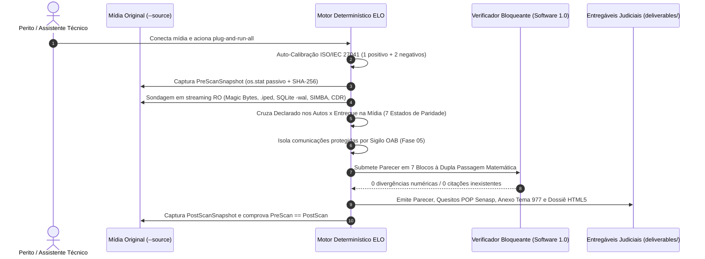

# 02 — Executive Briefing: Auditoria Probatória Digital com a Plataforma ELO

> **Público-Alvo**: Magistrados, Desembargadores, Ministros, Advogados Criminalistas, Defensores Públicos, Membros do Ministério Público, Peritos Oficiais e Assistentes Técnicos.

---

## 1. Por que a Prova Digital Exige Auditoria Matemática Determinística?

Diferentemente do vestígio físico tradicional (como um projétil balístico ou documento em papel), a **prova digital é intrinsecamente latente, frágil e mediada por camadas lógicas**. Uma simples abertura descuidada de um arquivo de banco de dados (`SQLite`) sem proteção de escrita modifica instantaneamente dezenas de bytes no cabeçalho do arquivo, invalidando seu código `SHA-256` original. Da mesma forma, uma planilha financeira exportada em múltiplos lotes pelo sistema `SIMBA` pode duplicar lançamentos bancários, inflando artificialmente o montante atribuído a um investigado se não houver reconciliação exata em centavos inteiros.

O ordenamento jurídico brasileiro consolidou balizas rigorosas para enfrentar essa fragilidade:
- **Código de Processo Penal (arts. 158-A a 158-F)**: instituiu as 10 etapas formais da Cadeia de Custódia, exigindo rastreabilidade cronológica desde o reconhecimento até o descarte.
- **STF Tema 977 e STJ (RHC 184.003/SP)**: firmaram a imprescindibilidade do acesso integral aos dados brutos (*mirroring* verificável por hash) para o exercício efetivo do contraditório e da ampla defesa, vedando condenações amparadas apenas em prints estáticos ou seleções unilaterais incomprováveis.
- **POP Senasp Vol. 5 — Informática Forense (2024)**: estabeleceu o protocolo técnico oficial das forças policiais brasileiras para isolamento radioelétrico, coleta *bitstream*/*full file system*, cálculo de hash na origem e exame exclusivo sobre cópia de trabalho.
- **Resolução CNJ n. 615/2025 e Recomendação CFOAB n. 001/2024**: disciplinam a auditabilidade algorítmica, a vedação de decisões ou peças baseadas em alucinações de IA e o dever inegociável de sigilo local sobre dados cobertos por segredo de justiça ou prerrogativa profissional.

---

## 2. Como a Plataforma ELO Funciona na Prática (*Plug-and-Analyze*)

A plataforma **ELO** foi desenhada para eliminar o erro humano e a subjetividade técnica. O operador aponta apenas dois parâmetros:
1. `--source`: o HD externo, pendrive acautelado, imagem forense ou pasta entregue nos autos (tratada sob **bloqueio absoluto de escrita**).
2. `--workspace`: uma pasta limpa no computador pericial onde todos os cálculos, índices e relatórios serão construídos sem jamais tocar na mídia original.

---

## 3. O Que a Plataforma Detecta Automaticamente para o Processo

| Situação Crítica nos Autos | Como o ELO Detecta de Forma Objetiva e Reprodutível | Relevância Processual Direta |
| :--- | :--- | :--- |
| **Omissão de Mídia Bruta / Entrega Seletiva** | A Matriz de Paridade confronta cada item listado no Auto de Apreensão/FAV/Laudo contra todos os arquivos presentes no HD, sinalizando `DECLARED_RAW_NOT_DELIVERED` ou `MATCHED_WITHOUT_ORIGIN_HASH`. | Fundamenta petição imediata de acesso à integralidade (**STF Tema 977** e **CPP art. 159, § 5º**). |
| **Caso Portátil `.iped` Processado em Modo Rápido ou Contaminado** | O módulo `StateIpedCaseAuditor` inspeciona os arquivos de configuração do `.iped` estatal e identifica perfis omissivos (`fastmode`/`triage`), `deleteIgnoredItems` ativo ou download externo (`--downloadInternetData`). | Demonstra perda de vestígios exculpatórios (como mensagens apagadas não recuperadas) ou contaminação externa da prova. |
| **Violação ou Troca de Lacres / Caracteres Homógrafos** | O avaliador da Fase 02 compara algebricamente os números de lacre de entrada e saída na FAV e detecta substituições visuais enganosas (ex.: letra `O` ou cirílico no lugar do dígito `0`). | Evidencia quebra documentada na cadeia de custódia (**CPP arts. 158-B e 158-D**). |
| **Mensagens ou Arquivos Criados APÓS a Apreensão Policial** | Todo evento extraído é convertido para `UTC` e confrontado com o minuto exato da apreensão (`seizure_utc`); eventos posteriores recebem flag `is_post_seizure = True` (ex.: manuseio sem isolamento de rede/modo avião). | Comprova violação do Eixo 1 de Preservação (**POP Senasp Vol. 5 — 2024** e **STJ RHC 184.003/SP**). |
| **Dupla Contagem Financeira em Quebras Bancárias (SIMBA)** | O parser financeiro converte cada centavo em inteiro exato (`BIGINT`) e identifica transações idênticas repetidas em arquivos de remessa sobrepostos (`is_inter_file_duplicate`), calculando o valor exato da inflação em reais (`financial_inflation_cents`). | Desconstitui excesso de imputação patrimonial ou bloqueio cautelar desproporcional. |
| **Saltos Geográficos Impossíveis em ERBs e CGNAT sem Porta Lógica** | Calcula a velocidade geodésica entre antenas consecutivas (`impossible_speed_flag`) e audita se registros de IP compartilhado informam a porta lógica de origem exigida pelo **Decreto n. 12.975/2026**. | Afasta presunções indevidas de presença física ou autoria em conexões compartilhadas por milhares de usuários. |
| **Mensagens Deletadas Omitidas no Relatório Policial** | O inspetor binário SQLite (**NIST IR 8354**) varre páginas `freelist`, espaço não alocado e transações `-wal` não consolidadas, recuperando diálogos de contexto omitidos e rotulando sua origem exata (`CARVED_FREELIST_OR_UNALLOCATED`). | Restabelece a completude contextual de diálogos truncados (*cherry-picking*). |
| **Comunicações Protegidas entre Advogado e Cliente** | Na Fase 05, o `PrivilegeShieldFilter` segrega preventivamente comunicações cobertas pela inviolabilidade profissional (**Lei 8.906/94, art. 7º, II**), impedindo sua exposição indevida. | Protege prerrogativas constitucionais da defesa técnica. |

---

## 4. Garantias de Confiança para o Juízo e para as Partes

1. **Zero Alucinação por Construção Arquitetural**: Diferentemente de assistentes genéricos de IA, no ELO nenhum modelo generativo realiza contas, lê hashes ou redige livremente sem supervisão. O `BlockingVerifierEngine` confere caractere por caractere todos os hashes `SHA-256`, valores em reais, contagens e identificadores `ControlNumber` contra o banco de dados factual antes de permitir a gravação do parecer. Se houver um único centavo ou dígito divergente, a emissão é bloqueada (`BlockingVerificationError`).
2. **Imparcialidade Epistêmica Estrita**: Todo registro recebe obrigatoriamente um dos 4 rótulos epistêmicos (`VERIFIED_FACT`, `STATE_ALLEGATION`, `ANALYTICAL_INFERENCE` ou `EXPLICIT_GAP`), jamais confundindo alegação policial com fato matematicamente verificado no suporte digital.
3. **Verificabilidade Universal Offline**: O entregável `phase07_dossie_interativo_offline.html` abre em qualquer navegador padrão sem internet, e o script `phase06_reproducao_independente.sh` permite que o perito do juízo ou da parte contrária recalcule cada hash de ponta a ponta em minutos.
