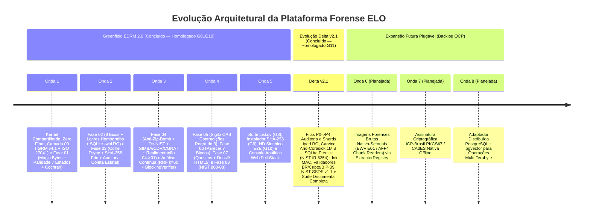

# 04 — Roadmap Evolutivo e Backlog Técnico: Plataforma Forense ELO

Este documento registra a linha do tempo construtiva já concluída e homologada da plataforma **ELO** (**Ondas 1 a 5 do EDRM 2.0 Greenfield** + **Evolução Cirúrgica Delta v2.1**) e define o **Backlog de Expansão Futura** desenhado para acoplar-se por extensão pura (*Open/Closed Principle — OCP*) sem modificar casos de uso estabilizados.

---

## 1. Visão Cronológica Consolidada (Ondas Concluídas e Futuras)

---

## 2. Detalhamento das Entregas Homologadas (100% Concluídas)

| Marco / Onda | Escopo Técnico Entregue | Portões Validados | Status |
| :--- | :--- | :--- | :--- |
| **Onda 1** | `edrm.shared_kernel` (contratos, enums, VOs, parser BRL em centavos, normalizador UTC multi-época), `edrm.igrm_governance` e `edrm.phase01_identification`. | `G0`, `G1`, `G2`, `G3` | **CONCLUÍDO (`PASS`)** |
| **Onda 2** | `edrm.phase02_preservation` (6 Eixos, homógrafos, saúde SQLite imutável, SPOF) e `edrm.phase03_collection` (`os.fsync` + releitura fria + auditoria de coleta estatal). | `G4` | **CONCLUÍDO (`PASS`)** |
| **Onda 3** | `edrm.phase04_processing` (piso funcional EDRM 1.0–5.0, SIMBA, CDR/ERB, CGNAT, realimentação `04 -> 01`, 5 relatórios) e `edrm.continuous_analysis` (`RRF k=60`, `PromptInjectionShield`, `BlockingVerifierEngine`). | `G5`, `G6` | **CONCLUÍDO (`PASS`)** |
| **Onda 4** | `edrm.phase05_review`, `edrm.phase06_production`, `edrm.phase07_presentation` e `edrm.phase08_disposition` (ciclo completo até o descarte auditado). | `G7` | **CONCLUÍDO (`PASS`)** |
| **Onda 5** | Testes de Substituição de Liskov (`tests/contract`), HD sintético ponta a ponta (`tests/e2e_synthetic`), `materialize_elo_platform.py` e Console Web (`server.ts` + `src/components/*`). | `G8`, `G9`, `G10` | **CONCLUÍDO (`PASS`)** |
| **Delta v2.1** | `PriorityTierScheduler` ($P_0 \rightarrow P_4$), `StateIpedCaseAuditor`, `StateIpedStorageReaderAdapter` (16 shards GZIP RO), `SQLiteDeletedRecordsInspector`, `WindowsArtifactProvenanceExtractor` (`.lnk`), `validators_br_crypto.py`, `compressibility_probe.py`, `CompressedRoaringBitset`, `ExactMetricSimilarity`, `ForensicLoopbackHttpServer` (`127.0.0.1` + `X-ELO-Session-Token`), NIST SSDF v1.1 e Suíte Documental de 18 artefatos + `materialize_docs.py`. | `G11` (`G11.1` a `G11.5`) | **CONCLUÍDO (`PASS`)** |

---

## 3. Backlog Técnico Estruturado de Expansão Futura (Pós-v2.1)

Graças ao isolamento hexagonal e aos registros plugáveis (`SignatureRegistry` na Fase 01 e `ExtractorRegistry` na Fase 04), todas as evoluções abaixo conectam-se **sem alterar nenhuma classe de domínio ou caso de uso existente**:

### Épico E-01: Leitura Setorial Nativa de Imagens `EWF (.E01)` e `AFF4`
- **Contexto**: Atualmente, imagens `.E01` e `.aff4` são identificadas por *Magic Bytes* (`MagicSignature.EWF_E01` e `MagicSignature.AFF4`), adquiridas com verificação fria na Fase 03 e auditadas na Matriz de Paridade.
- ** Ponto de Extensão (`OCP`)**: Implementar `EwfChunkStreamAdapter` e `Aff4ZipTurtleAdapter` na camada `phase04_processing/infrastructure/` e registrá-los via `ExtractorRegistry.register(...)`.
- **Critério de Aceite**: Descompressão *streaming* de blocos `zlib` internos do `.E01` verificando `Adler32` por chunk e hash `MD5`/`SHA-256` do rodapé sem montar dispositivos de bloco em kernel (`root` não exigido).

### Épico E-02: Decodificação Nativa de Árvores de Registro Windows (`Registry Hives REGF`) e `$UsnJrnl`
- **Contexto**: O Delta v2.1 já extrai `MachineID`, `VolumeSerial` e `DroidBirth MAC` diretamente de binários `.lnk` (`PureWindowsLnkBinaryParser`).
- **Ponto de Extensão (`OCP`)**: Registrar assinatura `REGF` (`62 65 67 66` / `regf`) em `SignatureRegistry` e adicionar parser puro `PureWindowsRegfUsbStorParser` em `phase04_processing/domain/` para correlacionar `SYSTEM\CurrentControlSet\Enum\USBSTOR` com os GUIDs `DroidVolume` já extraídos dos arquivos `.lnk`.
- **Critério de Aceite**: Emissão automática de registros `WindowsLinkProvenanceRecord` adicionais com `artifact_kind="USBSTOR_REGISTRY"` e cobertura por teste unitário hermético.

### Épico E-03: Carimbo do Tempo Criptográfico Offline e Assinatura `PKCS#7 / CAdES` ICP-Brasil
- **Contexto**: As Fases 03 e 06 já produzem manifestos destacados estruturados (`phase03_icp_manifest.json` e `phase06_icp_detached_manifest.json`).
- **Ponto de Extensão (`OCP`)**: Implementar adaptador opcional `Pkcs11TokenIcpSignerAdapter` assinando o hash canônico de `MANIFESTO_SHA256.txt` via token criptográfico físico (`A3`) local sem conexão externa.
- **Critério de Aceite**: Validação offline da cadeia `ICP-Brasil` contra lista de certificados raiz embarcada no repositório.

### Épico E-04: Promoção Transparente para Cluster Local `PostgreSQL + pgvector` em Operações Multi-Terabyte
- **Contexto**: `PostgresPgvectorStoreAdapter` já possui contrato espelhado com `SqliteFtsVectorStoreAdapter` sob a porta `HybridSearchIndexPort`.
- **Ponto de Extensão (`OCP`)**: Parametrizar `EloForensicContainer` via flag `--catalog-backend {sqlite,postgres-local}` vinculada estritamente ao socket Unix local ou `127.0.0.1`, preservando a suíte de equivalência de Liskov (`G8`).
- **Critério de Aceite**: Identidade exata de ranking `RRF (k=60)` entre `SQLite FTS5` e `PostgreSQL tsvector + pgvector` sobre o mesmo corpus de teste.
