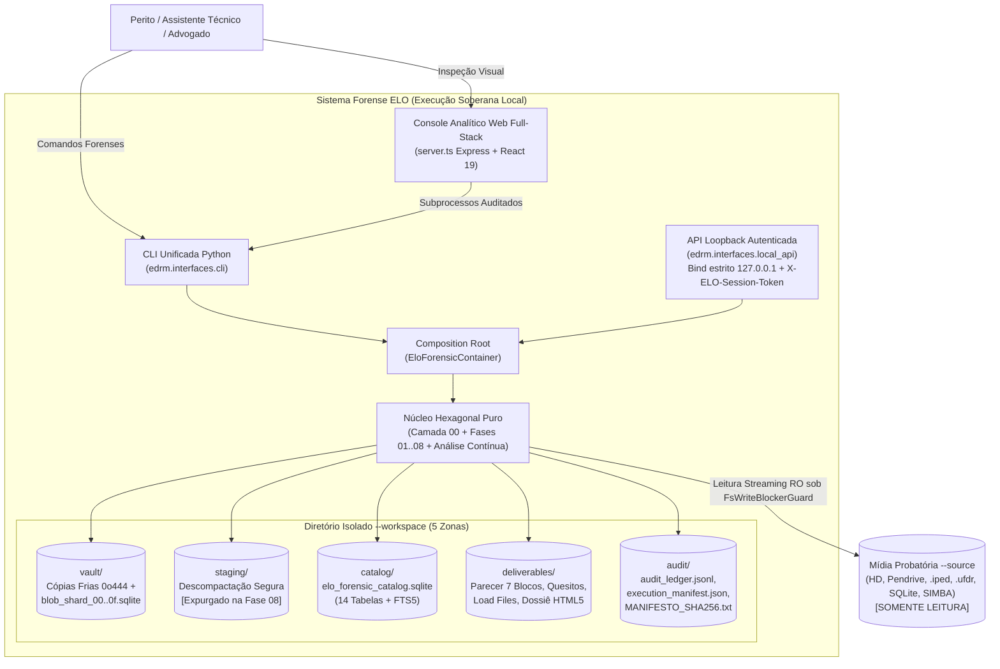
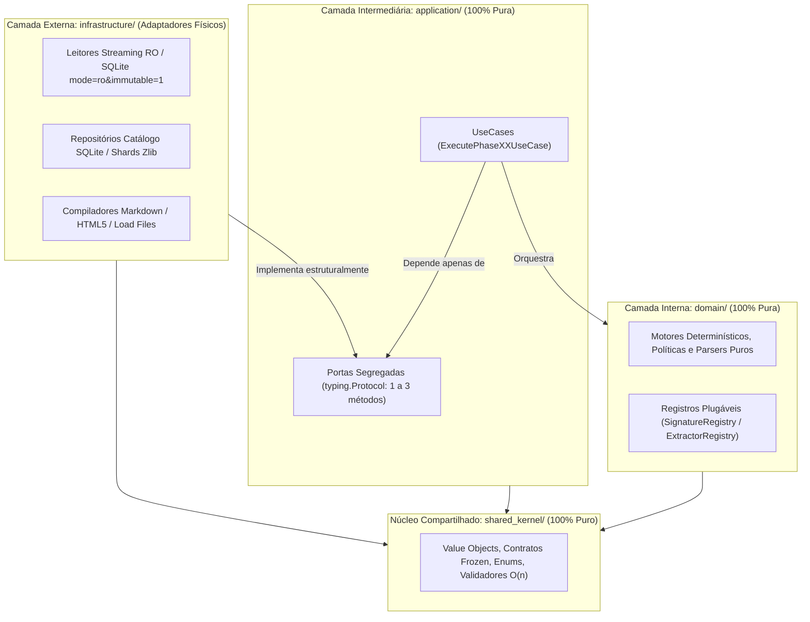
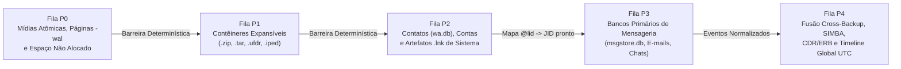

# 06 — System Blueprint: Arquitetura Clean, Hexagonal e SOLID (EDRM 2.0 + Delta v2.1)

A plataforma **ELO** implementa uma combinação rigorosa de **Clean Architecture**, **Arquitetura Hexagonal (*Ports & Adapters*)** e **Enterprise SOLID**, onde todas as regras de acoplamento, pureza de camadas e tipagem imutável são verificadas automaticamente pela árvore sintática (`ast`) no **Portão `G1`** antes de qualquer execução.

---

## 1. Diagrama de Contexto e Contêineres (Modelo C4)

---

## 2. Anatomia Interna Hexagonal de Cada Pacote de Fase

Todos os 10 módulos verticais em `src/edrm/` (`igrm_governance`, `phase01_identification` a `phase08_disposition` e `continuous_analysis`) obedecem exatamente à mesma topologia concêntrica:

### Regras de Pureza Auditadas via AST (`tests/architecture/__init__.py`)
1. **Zero I/O no Centro**: `shared_kernel/`, `domain/` e `application/` são proibidos de importar `os`, `sys`, `shutil`, `glob`, `subprocess`, `sqlite3`, `psycopg`, `zipfile`, `tarfile`, `socket`, `http`, `urllib` ou `requests`.
2. **Isolamento Horizontal Absoluto entre Fases**: Nenhum pacote `phaseXX_*` importa qualquer símbolo de `phaseYY_*`, `igrm_governance` ou `continuous_analysis`. A transição de estado ocorre exclusivamente por objetos `@dataclass(frozen=True, slots=True)` definidos em `edrm.shared_kernel.contracts`.
3. **Realimentação Iterativa Desacoplada (`04 -> 01`)**: Quando `ExecutePhase04ProcessingUseCase` descompacta contêineres em `staging/` e encontra novas peças processuais primárias (ex.: uma `FAV` ou aditamento de `Laudo` dentro de um `.zip`), ele emite um `IterativeDiscoveryFeedbackPayload` através da porta `IterativeDiscoveryFeedbackPort` (`shared_kernel.contracts`), que o `EloForensicContainer` conecta a `ReceiveIterativeFeedbackUseCase` (Fase 01), gerando `revision_number = 2+` sem criar dependência cíclica.

---

## 3. Mapa Completo de Pacotes, Casos de Uso, Portas e Adaptadores

| Pacote Vertical | Motores de Domínio (`domain/`) | Casos de Uso & Portas (`application/`) | Adaptadores Físicos (`infrastructure/`) |
| :--- | :--- | :--- | :--- |
| **`igrm_governance`** | `CaseWorkspaceLayout`, `SourceWriteBlockerPolicy`, `SecrecyNetworkPolicy`, `SelfCalibrationSuite` | `CalibrateToolsUseCase`, `InitializeCaseWorkspaceUseCase` (`WorkspaceProvisionerPort`, `AuditLedgerPort`, `ClockPort`) | `FsWriteBlockerGuard`, `FsWorkspaceProvisionerAdapter`, `AppendOnlyLedgerAdapter`, `SubprocessSandboxSupervisor`, `SystemUtcClockAdapter` |
| **`phase01_identification`** | `SignatureRegistry`, `SchemaDiscoveryEngine`, `PrimaryDocumentClassifierAndExtractor`, `CopyReconciliationEngine`, `ParityMatrixEngine`, `CochranFiniteSampler`, `StateIpedCaseAuditor` | `ExecutePhase01IdentificationUseCase`, `ReceiveIterativeFeedbackUseCase` (`MediaSensorProbePort`, `Phase01CatalogRepositoryPort`, `Phase01ReportCompilerPort`) | `ReadOnlyMediaScannerAdapter`, `SqliteCatalog01RepositoryAdapter`, `Phase01MarkdownCompilerAdapter` |
| **`phase02_preservation`** | `SpofRedundancyEvaluator`, `StateOriginPreservation6AxesEvaluator`, `detect_seal_homograph_or_mismatch` | `ExecutePhase02PreservationUseCase` (`StructuralHealthRunnerPort`, `Phase02PersistenceAndReportPort`) | `ImmutableStructuralHealthAdapter`, `Phase02CatalogAndMarkdownAdapter` |
| **`phase03_collection`** | `AcquisitionPlanner`, `StateCollectionMethodAuditor` | `ExecutePhase03CollectionUseCase` (`VerifiedVaultCopierPort`, `Phase03ManifestAndReportPort`) | `FsyncColdVerifyCopierAdapter`, `Phase03ManifestAndReportAdapter` |
| **`phase04_processing`** | `PriorityTierScheduler` ($P_0 \rightarrow P_4$), `DeNistAndLogicalDedupPolicy`, `PureTabularForensicParsers`, `ExtractorRegistry`, `PureSqliteBinaryForensicCarver`, `PureWindowsLnkBinaryParser` | `ExecutePhase04ProcessingUseCase` (`SafeUnpackAndIpedPort`, `UniversalExtractorRunnerPort`, `Phase04CatalogAndFiveReportsPort`) | `SafeContainerUnpackerAdapter`, `UniversalExtractorRunnerAdapter`, `Phase04CatalogAndFiveReportsAdapter`, `IpedCliExternalBridge`, `StateIpedStorageReaderAdapter`, `ShardedBlobVaultStore`, `ContainerExpansionCheckpointManager`, `StreamingSignatureCarver`, `SQLiteDeletedRecordsInspector`, `WindowsArtifactProvenanceExtractor`, `AudioTranscriptDeduplicatedCache` |
| **`continuous_analysis`** | `DeterministicHashEmbedder`, `ExactMetricSimilarity`, `HybridRrfFusionEngine`, `UnifiedUtcTimelineBuilder`, `PromptInjectionShield`, `BlockingVerifierEngine`, `CochranElusionRuleOf3Qc` | `HybridSearchUseCase`, `GovernedAiInterpretAndVerifyUseCase` (`HybridSearchIndexPort`, `LocalGovernedLlmPort`, `AiAndQcAuditRepositoryPort`) | `SqliteFtsVectorStoreAdapter`, `PostgresPgvectorStoreAdapter`, `LocalLlmEndpointAdapter`, `AiAndQcAuditRepositoryAdapter` |
| **`phase05_review`** | `CompressedRoaringBitset`, `PrivilegeShieldFilter`, `MaterialContradictionDetector`, `EvidentiaryDefectClassifier` | `ExecutePhase05ReviewUseCase` (`Phase05ReviewPersistencePort`) | `Phase05ReviewStoreAdapter` |
| **`phase06_production`** | `SevenBlockExpertOpinionBuilder`, `LoadFileBuilder` | `ExecutePhase06ProductionUseCase` (`Phase06DeliverablesWriterPort`) | `Phase06DeliverablesWriterAdapter` |
| **`phase07_presentation`** | `StrategicInterrogatoryBuilder`, `OfflineHtmlDossierCompiler` | `ExecutePhase07PresentationUseCase` (`Phase07PresenterWriterPort`) | `Phase07PresenterWriterAdapter` |
| **`phase08_disposition`** | `PostJudgmentDispositionPolicy`, `Nist80088Certificate` | `ExecutePhase08DispositionUseCase` (`StagingPurgeAndBundlePort`, `NistSanitizerWriterPort`) | `StagingCleanerAndBundleAdapter`, `Nist80088SanitizerAdapter` |

---

## 4. Orquestração em 5 Filas de Dependência na Fase 04 ($P_0 \rightarrow P_4$)

Introduzido no **Delta v2.1**, o `PriorityTierScheduler` garante que artefatos referenciais (como agendas de contatos `wa.db` ou tabelas de contas) sejam sempre extraídos **antes** dos bancos de mensagens que dependem deles:

---

## 5. Composition Root Sem Estado Global (`EloForensicContainer`)

O arquivo `src/edrm/bootstrap/container.py` é o **único ponto do sistema** autorizado a conhecer simultaneamente todas as fases e adaptadores concretos:
- Instancia cada adaptador sem variáveis globais mutáveis (`Singletons` implícitos são proibidos).
- Envolve toda a execução `01` $\rightarrow$ `08` no gerenciador de contexto `with FsWriteBlockerGuard(...)`, assegurando restauração limpa dos hooks de sistema operacional mesmo diante de exceções abruptas.
- Registra no razão `audit/audit_ledger.jsonl` o evento criptográfico de selagem (`PHASE_01_SEALED` .. `PHASE_08_DISPOSITION_SEALING`) com o `contract_sha256()` canônico de cada transição antes da geração final de `MANIFESTO_SHA256.txt`.
