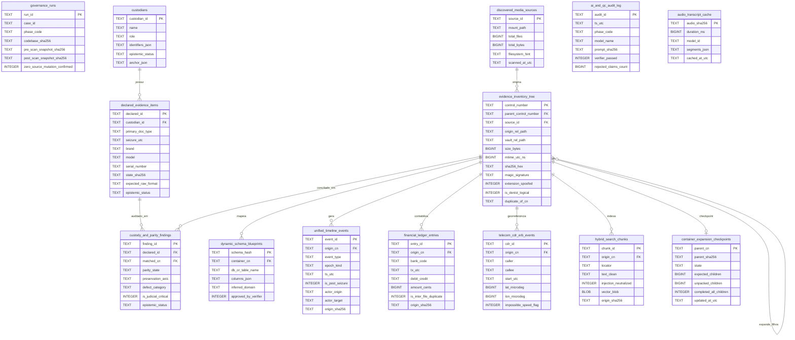

# 07 — Modelo Relacional de Dados, Shards e Dicionário de Contratos Imutáveis

Este documento descreve com fidelidade integral o esquema relacional SQLite persistido em `catalog/elo_forensic_catalog.sqlite` (`src/edrm/shared_kernel/schema_sql.py`), a arquitetura dos **16 shards locais de blobs** e dos **16 shards externos `.iped`**, os **Objetos de Valor** (`value_objects.py`) e todos os **40 Contratos Imutáveis** (`contracts.py`).

---

## 1. Diagrama Entidade-Relacionamento (`elo_forensic_catalog.sqlite`)

O catálogo central materializa **15 objetos DDL** (14 tabelas relacionais + 1 tabela virtual `FTS5`), utilizando exclusivamente `BIGINT` / `INTEGER` para bytes, durações, centavos monetários e micrograus geográficos (zero `REAL`/`FLOAT`).

> **Tabela Virtual Léxica (`15º objeto DDL`)**: `hybrid_search_fts USING fts5(chunk_id UNINDEXED, origin_cn, locator, text_clean)` sincronizada 1:1 com `hybrid_search_chunks` para ranking `BM25` determinístico.

---

## 2. Arquitetura de Sharding Binário (Local e Interoperabilidade `.iped`)

### 2.1 Cofre Local Deduplicado (`ShardedBlobVaultStore`)
Localizado em `vault/blob_shards/blob_shard_00.sqlite` até `blob_shard_0f.sqlite` (16 bancos independentes):
- **Função de Particionamento**: primeiro nibble hexadecimal do `SHA-256` (`int(sha256_hex[0], 16)` $\in [0..15]$).
- **Tabela Interna**: `blobs(sha256_hex TEXT PRIMARY KEY, raw_size_bytes BIGINT NOT NULL, zlib_payload BLOB NOT NULL)`.
- **Garantia**: compressão `zlib` nível 6 na escrita e conferência obrigatória `hashlib.sha256(raw).hexdigest() == sha256_hex` na leitura.

### 2.2 Leitor Clean-Room de Casos Portáteis `.iped` (`StateIpedStorageReaderAdapter`)
Quando `--source` contém um caso `.iped` entregue pelo Estado:
1. Abre `sleuth.db` (`tsk_files`) exclusivamente com `file:...?mode=ro&immutable=1` + `PRAGMA query_only = 1;`.
2. Calcula o shard de armazenamento pelos 4 bits mais significativos do primeiro byte do hash `MD5` (`compute_iped_shard_index(md5_hex) = int(md5_hex[:2], 16) >> 4` $\in [0..15]$), localizando `iped/data/storage-{0..15}.db`.
3. Abre o shard correspondente em modo estritamente imutável e descompacta a coluna `data` (`GZIP` da tabela `t1`) em *streaming* (`zlib.decompressobj(16 + zlib.MAX_WBITS)`), computando e verificando `SHA-256` sem gravar um único byte na mídia estatal.

---

## 3. Objetos de Valor Nucleares (`edrm.shared_kernel.value_objects`)

| Classe (`@dataclass(frozen=True, slots=True)`) | Invariante Validado no `__post_init__` | Métodos Utilitários |
| :--- | :--- | :--- |
| `Sha256Hash(value: str)` | Exatamente 64 caracteres hexadecimais minúsculos `[0-9a-f]{64}`. | `Sha256Hash.from_bytes(data)` |
| `ByteSize(value: int)` | `isinstance(value, int)` (rejeita `bool` e `float`) e `value >= 0`. | — |
| `CentsAmount(cents: int)` | Inteiro puro representando centavos exatos (positivo, zero ou negativo). | `to_decimal()`, `format_brl()` (`R$ 1.234,56`) |
| `MicroDegreesCoord(microdeg: int)` | Inteiro em milionésimos de grau ($1^\circ = 1.000.000\ \mu\text{deg}$) dentro de $[-180\times 10^6, +180\times 10^6]$. | — |
| `UtcTimestamp(iso_utc: str, epoch_seconds: int, origin_epoch: EpochKind)` | Sufixo `Z` obrigatório em ISO-8601 UTC + época rastreada (`1970`, `2001`, `1904`). | — |
| `SafeOsPath(normalized_posix: str)` | Caminho normalizado não vazio sem bytes nulos `\x00`. | `to_os_extended()`, `to_sqlite_immutable_uri()` |
| `ControlNumber(code: str)` | Padrão hierárquico `ELO-000001` (raiz) ou `ELO-000001.0001.0002` (filhos descompactados). | `root(seq)`, `child(idx)`, `parent_code()`, `is_top_level()` |
| `SourceAnchor(source_path, sha256_hex, locator, excerpt_verbatim)` | Âncora probatória completa exigida em todos os achados e peças técnicas. | `to_dict()` |

---

## 4. Dicionário Completo dos 40 Contratos Imutáveis (`edrm.shared_kernel.contracts`)

### 4.1 Contratos Principais de Transição entre Camadas (Assinados por `.contract_sha256()`)
| Contrato | Origem $\rightarrow$ Destino | Campos Estruturais Chave |
| :--- | :--- | :--- |
| `CaseGovernanceContract` | `00` $\rightarrow$ `Todas` | `case_id`, `run_id`, `workspace_root`, 5 diretórios (`vault_dir`..`audit_dir`), `catalog_db_path`, `protected_source_roots`, `secrecy_level`, `codebase_sha256`, `calibration_receipt` |
| `MediaAutoDiscoveryBlueprint` | Sonda $\rightarrow$ Fase `01` | `extension_census`, `signature_census`, `spoofed_files`, `encrypted_or_corrupted_files`, `probed_files`, `dynamic_schemas`, `primary_doc_candidates`, `state_iped_audit`, `headerless_encrypted_files` |
| `Phase01ToPhase02Contract` | `01` $\rightarrow$ `02` | `governance`, `pre_scan_snapshot`, `discovery_blueprint`, `custodians`, `declared_items`, `divergences`, `parity_matrix`, `cochran_plan`, `revision_number`, `state_iped_audit`, `headerless_encrypted_candidates` |
| `Phase02ToPhase03Contract` | `02` $\rightarrow$ `03` | `phase01_bundle`, `structural_findings`, `spof_map`, `six_axes_findings`, `legal_hold_id`, `approved_for_acquisition`, `phase02_report_sha256` |
| `Phase03ToPhase04Contract` | `03` $\rightarrow$ `04` | `phase02_bundle`, `vault_entries`, `state_collection_findings`, `icp_manifest_path`, `icp_manifest_sha256`, `phase03_report_sha256` |
| `Phase04ToPhase05Contract` | `04` $\rightarrow$ `05` | `phase03_bundle`, `updated_phase01_bundle`, métricas inteiras, `dead_letter_items`, `timeline_events`, `financial_entries`, `telecom_records`, `cgnat_records`, `anchored_chunks`, `official_five_reports`, `recovered_sqlite_records`, `link_provenance_records`, `tier_execution_order` |
| `Phase05ToPhase06Contract` | `05` $\rightarrow$ `06` | `phase04_bundle`, `privileged_excluded_cns`, `selected_review_cns`, `material_contradictions`, `classified_nullities`, `qc_summary`, `frozen_review_sha256` |
| `Phase06ToPhase07Contract` | `06` $\rightarrow$ `07` | `phase05_bundle`, `expert_opinion_path`, `expert_opinion_sha256`, `reproduction_script_path`, `concordance_dat_path`, `edrm_xml_path`, `verifier_double_pass_zero_errors` |
| `Phase07ToPhase08Contract` | `07` $\rightarrow$ `08` | `phase06_bundle`, `quesitos`, `quesitos_sha256`, `tema977_exhibit_path`, `offline_html_dossier_path`, `all_deliverables`, `authorize_staging_purge` |
| `FinalDispositionReceipt` | `08` $\rightarrow$ `00` | `staging_purged_files_count`, `staging_purged_bytes`, `vault_intact_verified`, `source_pre_post_snapshot_identical`, `post_scan_snapshot`, `manifest_sha256_path`, `recovery_bundle_path`, `nist_certificate_path` |

### 4.2 Registros Analíticos Atômicos Integrantes dos Contratos (30 Estruturas)
1. **Fotografia e Calibração**: `FileStatEntry`, `MediaSnapshot`, `CalibrationReceipt`.
2. **Descoberta e Paridade (Fase 01)**: `ProbedFileRecord`, `DynamicSchemaBlueprint`, `PrimaryDocumentCandidate`, `StateIpedAuditReport`, `CustodianRecord`, `DeclaredEvidenceItem`, `DivergenceRecord`, `ParityMatrixRow`, `CochranSamplePlan`.
3. **Preservação e Coleta (Fases 02 e 03)**: `StructuralHealthFinding`, `PreservationAxisFinding`, `SpofRiskEntry`, `VaultAcquiredEntry`, `StateCollectionFinding`.
4. **Realimentação e Processamento (Fase 04)**: `IterativeDiscoveryFeedbackPayload` (+ protocolo `IterativeDiscoveryFeedbackPort`), `TimelineEventRecord`, `FinancialLedgerEntryRecord`, `TelecomCdrRecord`, `CgnatAuditRecord`, `DeadLetterExceptionRecord`, `AnchoredTextChunk`, `RecoveredSqliteRecord`, `WindowsLinkProvenanceRecord`.
5. **Revisão e Apresentação (Fases 05 e 07)**: `MaterialContradictionRecord`, `ClassifiedNullityRecord`, `QualityControlSummary`, `CustomQuesitoRecord`.
