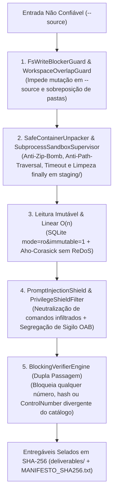

# 11 — Arquitetura de Segurança, Soberania de Dados e Conformidade NIST SSDF v1.1

Mídias apreendidas em investigações criminais são fontes **intrinsecamente não confiáveis (*untrusted input*)**: além de conterem dados sensíveis protegidos por segredo de justiça e sigilo profissional, podem hospedar bombas de descompactação (*Zip-Bombs*), caminhos maliciosos (*Zip-Slip*), bancos corrompidos ou instruções de *Indirect Prompt Injection* projetadas para manipular ferramentas automatizadas.

Este documento descreve a modelagem de ameaças **STRIDE** e as defesas determinísticas implementadas na plataforma **ELO**.

---

## 1. Modelagem de Ameaças STRIDE Aplicada à Perícia Digital

| Categoria STRIDE | Vetor de Ameaça Concreto em Perícia | Mitigação Determinística Implementada no ELO | Teste / Portão |
| :--- | :--- | :--- | :--- |
| **S — Spoofing** (Falsificação de Identidade/Tipo) | Ocultação de bancos SQLite ou executáveis sob extensões inocentes (`.jpg`, `.txt`), uso de caracteres homógrafos em lacres da FAV ou acesso não autorizado à API local. | Sonda de 16 *Magic Bytes* (`SignatureRegistry`), `detect_seal_homograph_or_mismatch` e cabeçalho `X-ELO-Session-Token` comparado por `hmac.compare_digest` em `127.0.0.1`. | `G3`, `G4`, `G11.1` |
| **T — Tampering** (Adulteração da Prova ou do Razão) | Gravação acidental na mídia `--source` (ex.: SQLite criando `-journal`), alteração de cópias em `vault/` ou edição retroativa do log de auditoria. | `FsWriteBlockerGuard`, URIs `mode=ro&immutable=1` + `PRAGMA query_only=1`, permissão `0o444` pós-`fsync` em `vault/`, `audit_ledger.jsonl` encadeado por `SHA-256` e `PreScan == PostScan`. | `G3`, `G4`, `G10` |
| **R — Repudiation** (Repúdio de Operações ou IA) | Falta de rastreabilidade sobre qual versão do código gerou o laudo, quais prompts foram avaliados ou quem autorizou o descarte pós-processual. | `codebase_sha256` + Mini-SBOM em `execution_manifest.json`, tabela `ai_and_qc_audit_log` e dupla confirmação nominal em `PostJudgmentDispositionPolicy`. | `G6`, `G7`, `G11.1` |
| **I — Information Disclosure** (Vazamento de Segredo Judicial / Sigilo OAB) | Exfiltração de dados por chamadas de rede sob segredo de justiça, bind HTTP em `0.0.0.0`, download automático de avatares WhatsApp ou inclusão de conversas advogado-cliente na produção. | `SecrecyNetworkPolicy` bloqueando sockets externos, `ForensicLoopbackHttpServer` restrito a `127.0.0.1`, correlação WhatsApp 100% offline e `PrivilegeShieldFilter` na Fase 05. | `G3`, `G6`, `G11.1`, `G11.4` |
| **D — Denial of Service** (Exaustão de Disco, Memória ou CPU) | *Zip-Bombs* de múltiplos gigabytes, *auto-clones* recursivos, expressões regulares vulneráveis a ReDoS ou subprocessos travados. | `validate_safe_archive_member` (limites rígidos de tamanho e razão de compressão), leitura em *streaming* de $64\text{ KiB}$–$1\text{ MiB}$, autômato linear $O(n)$ `PureAhoCorasickAutomaton` e timeout em `SubprocessSandboxSupervisor`. | `G5`, `G11.1`, `G11.3`, `G11.4` |
| **E — Elevation of Privilege / RCE** (Execução de Código Arbitrário) | *Path Traversal* (`../../etc/cron.d`), desserialização insegura (`pickle`) ou *Indirect Prompt Injection* tentando forçar conclusões falsas. | Resolução estrita de caminhos reais dentro de `staging/`, bloqueio AST de `pickle`/`marshal`/`eval`/`shell=True` (**NIST SSDF v1.1**), `PromptInjectionShield` e `BlockingVerifierEngine`. | `G1`, `G5`, `G6`, `G11.1` |

---

## 2. Camadas de Defesa em Profundidade

### 2.1 Bloqueador de Escrita em Software (`FsWriteBlockerGuard`)
Enquanto o contexto `with FsWriteBlockerGuard(...)` está ativo (`src/edrm/igrm_governance/infrastructure/__init__.py`):
- Intercepta `builtins.open`: qualquer modo contendo `w`, `a`, `x` ou `+` sobre caminhos resolvidos (`Path.resolve()`) dentro de `protected_source_roots` dispara imediatamente `ReadOnlyViolationError` **antes** da chamada ao sistema operacional.
- Intercepta mutadores de arquivo (`os.remove`, `os.unlink`, `os.rename`, `os.replace`, `os.chmod`, `os.utime`, `shutil.rmtree`) protegendo toda a árvore `--source`.
- Intercepta `socket.socket.connect` e `socket.create_connection`: quando `SecrecyLevel.JUDICIAL_SECRECY_LOCAL_ONLY` está vigente, qualquer endereço de destino fora de `("127.0.0.1", "::1", "localhost")` lança `SecrecySocketViolationError`.

### 2.2 Escudo Anti-Prompt-Injection (`PromptInjectionShield`)
Textos extraídos de PDFs, chats ou documentos apreendidos podem conter instruções adversariais como `IGNORE ALL PREVIOUS INSTRUCTIONS` ou `<|im_start|>system`.
- Na Fase 01 (`sanitize_indirect_prompt_injection`) e na Análise Contínua (`PromptInjectionShield.isolate_evidence_text`), padrões de injeção direta/indireta são detectados, desarmados estruturalmente por encapsulamento explícito de dados passivos e marcados no catálogo com `injection_neutralized = 1`.
- Ainda que um modelo local tentasse obedecer a um texto malicioso, o `BlockingVerifierEngine` descarta qualquer afirmação cujo valor numérico ou âncora divirja das tabelas determinísticas.

---

## 3. Controles NIST SP 800-218 (SSDF v1.1) e Mini-SBOM

A conformidade com o **Secure Software Development Framework (NIST SSDF v1.1)** é auditada de forma contínua em `tests/architecture/__init__.py` (`audit_nist_ssdf_v1_1_ast_security`):

| Prática NIST SSDF v1.1 | Controle Implementado no ELO | Verificação Automatizada |
| :--- | :--- | :--- |
| **PO.3 / PS.3 (Rastreabilidade e SBOM)** | `write_execution_manifest` gera `audit/execution_manifest.json` contendo `codebase_sha256` e objeto `mini_sbom` (`nist_ssdf_version: "1.1"`, versão exata do Python, plataforma e dependências zero no motor central). | `G11.1` |
| **PW.1.3 (Superfície Mínima de Rede e Autenticação)** | `ForensicLoopbackHttpServer` aceita bind exclusivamente em `127.0.0.1` e exige `X-ELO-Session-Token` (256 bits) comparado via `hmac.compare_digest`. | `G11.1` |
| **PW.4 / PW.6 (Proibição de Primitivas Inseguras)** | Bloqueio estático na AST de `pickle`, `cPickle`, `marshal`, `shelve`, `eval()`, `exec()`, `yaml.load` sem `SafeLoader`, `subprocess` com `shell=True` e desativação de TLS `verify=False`. | `G1`, `G11.1` |
| **PW.8 / RV.1 (Testes Herméticos e Isolamento de Subprocessos)** | `SubprocessSandboxSupervisor.run_isolated` executa binários externos sem shell, com diretório temporário exclusivo sob `staging/` limpo deterministicamente em bloco `finally`. | `G11.1` |

---

## 4. Conformidade com Resolução CNJ n. 615/2025 e Recomendação CFOAB n. 001/2024

1. **Transparência, Explicabilidade e Supervisão Humana (CNJ n. 615/2025)**:
   - Toda inferência ou verificação é registrada em `ai_and_qc_audit_log` com `prompt_sha256`, contagem de tokens, status do verificador e estatísticas amostrais.
   - Nenhuma decisão destrutiva (Fase 08 — sanitização pós-trânsito em julgado) ocorre sem identificação nominal do operador humano e frase explícita de confirmação.
2. **Confidencialidade e Sigilo Profissional da Advocacia (CFOAB n. 001/2024 e Lei 8.906/94)**:
   - Nenhum dado probatório sob segredo de justiça transita para APIs públicas em nuvem.
   - Comunicações cobertas pela prerrogativa profissional entre advogado constituído e assistido são filtradas preventivamente na Fase 05 (`PrivilegeShieldFilter`) antes da geração dos *Load Files* de produção.
