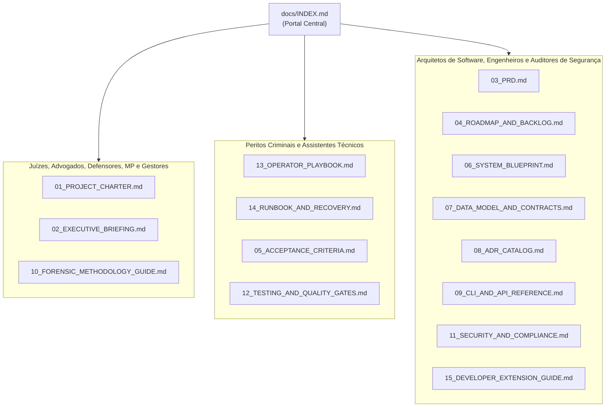

# Índice Mestre da Documentação Enterprise — Plataforma Forense ELO

Bem-vindo à base documental oficial da **Plataforma Forense ELO (EDRM 2.0 + Evolução Delta v2.1)**. Todos os 18 artefatos desta suíte foram redigidos a partir da inspeção direta da árvore sintática (`AST`), esquemas relacionais SQL, contratos imutáveis e portões automatizados (`G0` a `G11`) do código-fonte real.

---

## 1. Mapa de Navegação por Perfil de Leitor

---

## 2. Catálogo Estruturado dos 18 Documentos Oficiais

### A. Documentos Raiz do Repositório
1. **[`/README.md`](../README.md)** — Visão geral da plataforma, os 8 Pilares Periciais Determinísticos, diagrama macroscópico do ciclo `00` $\rightarrow$ `08`, árvore de pacotes, estrutura das 5 zonas de `--workspace` e guia rápido de execução.
2. **[`/CHANGELOG.md`](../CHANGELOG.md)** — Registro histórico auditável da construção Greenfield (Ondas 1 a 5 — v2.0.0) e da refatoração aditiva IPED Clean-Room + NIST SSDF v1.1 (Delta v2.1.0).
3. **[`/OPERATORS_MANUAL.md`](../OPERATORS_MANUAL.md)** — Guia dedicado para operadores forenses: interpretação detalhada do `StateIpedCaseAuditor`, resposta a incidentes de divergência de hash na verificação de manifesto e fluxo ponta a ponta dos quesitos automáticos.

### B. Produto, Visão e Planejamento (`/docs/01_product/`)
3. **[`01_PROJECT_CHARTER.md`](01_product/01_PROJECT_CHARTER.md)** — Termo de abertura do projeto: assimetria informacional na prova digital penal, objetivos mensuráveis, fronteiras de escopo (*In-Scope* / *Out-of-Scope*), premissas operacionais e matriz de partes interessadas.
4. **[`02_EXECUTIVE_BRIEFING.md`](01_product/02_EXECUTIVE_BRIEFING.md)** — Briefing executivo em linguagem jurídico-pericial clara: como o paradigma *Plug-and-Analyze* audita a cadeia de custódia (CPP arts. 158-A a 158-F), protege prerrogativas (CFOAB 001/2024) e elimina riscos de alucinação de IA (CNJ 615/2025).
5. **[`03_PRD.md`](01_product/03_PRD.md)** — Documento de Requisitos de Produto: catálogo exaustivo de Requisitos Funcionais (`RF-00` a `RF-08` + `RF-CA`) e Requisitos Não-Funcionais (`RNF-01` a `RNF-10`) rastreados diretamente aos casos de uso implementados.
6. **[`04_ROADMAP_AND_BACKLOG.md`](01_product/04_ROADMAP_AND_BACKLOG.md)** — Linha evolutiva consolidada das Ondas `1` a `5` + `Delta v2.1`, métricas de entrega por portão e backlog técnico futuro extensível via *Open/Closed Principle* (`OCP`).
7. **[`05_ACCEPTANCE_CRITERIA.md`](01_product/05_ACCEPTANCE_CRITERIA.md)** — Critérios formais de aceitação e *Definition of Done* (`DoD`): invariantes matemáticos de cada contrato de transição, artefatos obrigatórios em `deliverables/` e tolerância zero de divergência no Verificador Bloqueante.

### C. Engenharia, Blueprint e Dados (`/docs/02_architecture/`)
8. **[`06_SYSTEM_BLUEPRINT.md`](02_architecture/06_SYSTEM_BLUEPRINT.md)** — Planta baixa da arquitetura Clean + Hexagonal (*Ports & Adapters*), diagramas C4 (Contexto, Contêineres e Componentes), regras de pureza de domínio auditadas por AST e injeção de dependência em `EloForensicContainer`.
9. **[`07_DATA_MODEL_AND_CONTRACTS.md`](02_architecture/07_DATA_MODEL_AND_CONTRACTS.md)** — Modelo relacional completo das 15 estruturas DDL de `elo_forensic_catalog.sqlite`, topologia dos 16 shards locais (`blob_shard_00..0f.sqlite`) e leitura dos 16 shards IPED (`storage-0..15.db`), mais o dicionário integral dos 40 contratos `@dataclass(frozen=True, slots=True)`.
10. **[`08_ADR_CATALOG.md`](02_architecture/08_ADR_CATALOG.md)** — Catálogo de Decisões Arquiteturais (`ADR-001` a `ADR-008`): justificativas técnicas, alternativas rejeitadas e consequências das escolhas de engenharia determinística.
11. **[`09_CLI_AND_API_REFERENCE.md`](02_architecture/09_CLI_AND_API_REFERENCE.md)** — Manual de referência completo dos 6 subcomandos da CLI Python (`edrm.interfaces.cli`), da API HTTP Loopback `127.0.0.1` (`ForensicLoopbackHttpServer` + `X-ELO-Session-Token`) e das rotas REST do Console Web (`server.ts`).

### D. Metodologia Forense, Segurança e Qualidade (`/docs/03_forensic_compliance/`)
12. **[`10_FORENSIC_METHODOLOGY_GUIDE.md`](03_forensic_compliance/10_FORENSIC_METHODOLOGY_GUIDE.md)** — Guia metodológico pericial: reconciliação normativa estrita (**EDRM 2.0**, **IGRM v4.1**, piso funcional **EDRM 1.0–5.0**, **ISO/IEC 27037/27041/27042**, **NIST IR 8354**, **NIST SP 800-88 Rev. 2**, **CPP** e **POP Senasp Vol. 5 — 2024**).
13. **[`11_SECURITY_AND_COMPLIANCE.md`](03_forensic_compliance/11_SECURITY_AND_COMPLIANCE.md)** — Arquitetura de segurança e conformidade: modelagem de ameaças **STRIDE**, `FsWriteBlockerGuard`, bloqueio de rede sob segredo de justiça, defesas Anti-Zip-Bomb / Anti-Path-Traversal / Anti-Prompt-Injection e controles **NIST SSDF v1.1** + Mini-SBOM.
14. **[`12_TESTING_AND_QUALITY_GATES.md`](03_forensic_compliance/12_TESTING_AND_QUALITY_GATES.md)** — Engenharia de qualidade e validação empírica: calibração ISO/IEC 27041, amostragem estratificada de Cochran, Teste de Elusão, Regra do 3 de Hanley & Lippman-Hand ($3/n$), testes de contrato de Liskov e anatomia detalhada dos portões `G0` a `G11`.

### E. Operação, Uso Prático e Expansão (`/docs/04_operations/`)
15. **[`13_OPERATOR_PLAYBOOK.md`](04_operations/13_OPERATOR_PLAYBOOK.md)** — Manual operacional do perito e assistente técnico: montagem segura de mídias, fluxo completo de abertura e processamento de caso, auditoria de casos `.iped` estatais, buscas RRF, conferência de `MANIFESTO_SHA256.txt` e exportação do Dossiê HTML5 Offline.
16. **[`14_RUNBOOK_AND_RECOVERY.md`](04_operations/14_RUNBOOK_AND_RECOVERY.md)** — Runbook de incidentes e recuperação de desastres: tabela completa das 12 exceções forenses tipadas, retomada de contêineres via `container_expansion_checkpoints`, reconstrução a partir de `elo_case_recovery.bundle` e rito pós-trânsito em julgado.
17. **[`15_DEVELOPER_EXTENSION_GUIDE.md`](04_operations/15_DEVELOPER_EXTENSION_GUIDE.md)** — Guia de extensão para engenheiros: como registrar novas assinaturas em `SignatureRegistry`, criar novos extratores em `ExtractorRegistry`, implementar adaptadores respeitando Liskov (`LSP`) e validar tudo nos portões `G0`–`G11`.
18. **[`docs/INDEX.md`](INDEX.md)** — Este índice mestre navegável e matriz de rastreabilidade documental.

---

## 3. Matriz de Rastreabilidade Rápida: Código $\leftrightarrow$ Documentação

| Pacote / Artefato no Repositório | Documentos de Referência Primária |
| :--- | :--- |
| `src/edrm/shared_kernel/*` | `07_DATA_MODEL_AND_CONTRACTS.md`, `08_ADR_CATALOG.md`, `14_RUNBOOK_AND_RECOVERY.md` |
| `src/edrm/igrm_governance/*` | `06_SYSTEM_BLUEPRINT.md`, `10_FORENSIC_METHODOLOGY_GUIDE.md`, `11_SECURITY_AND_COMPLIANCE.md` |
| `src/edrm/phase01_identification/*` | `03_PRD.md`, `10_FORENSIC_METHODOLOGY_GUIDE.md`, `13_OPERATOR_PLAYBOOK.md` |
| `src/edrm/phase02_preservation/*` | `03_PRD.md`, `05_ACCEPTANCE_CRITERIA.md`, `10_FORENSIC_METHODOLOGY_GUIDE.md` |
| `src/edrm/phase03_collection/*` | `03_PRD.md`, `10_FORENSIC_METHODOLOGY_GUIDE.md`, `13_OPERATOR_PLAYBOOK.md` |
| `src/edrm/phase04_processing/*` | `06_SYSTEM_BLUEPRINT.md`, `07_DATA_MODEL_AND_CONTRACTS.md`, `08_ADR_CATALOG.md`, `15_DEVELOPER_EXTENSION_GUIDE.md` |
| `src/edrm/continuous_analysis/*` | `06_SYSTEM_BLUEPRINT.md`, `08_ADR_CATALOG.md`, `11_SECURITY_AND_COMPLIANCE.md`, `12_TESTING_AND_QUALITY_GATES.md` |
| `src/edrm/phase05_review/*` a `phase08_disposition/*` | `03_PRD.md`, `05_ACCEPTANCE_CRITERIA.md`, `10_FORENSIC_METHODOLOGY_GUIDE.md`, `14_RUNBOOK_AND_RECOVERY.md` |
| `src/edrm/interfaces/*` & `server.ts` | `09_CLI_AND_API_REFERENCE.md`, `11_SECURITY_AND_COMPLIANCE.md`, `13_OPERATOR_PLAYBOOK.md` |
| `tools/run_forensic_gates.py` & `tests/*` | `05_ACCEPTANCE_CRITERIA.md`, `12_TESTING_AND_QUALITY_GATES.md`, `15_DEVELOPER_EXTENSION_GUIDE.md` |
| `materialize_elo_platform.py` & `materialize_docs.py` | `README.md`, `13_OPERATOR_PLAYBOOK.md`, `14_RUNBOOK_AND_RECOVERY.md` |
